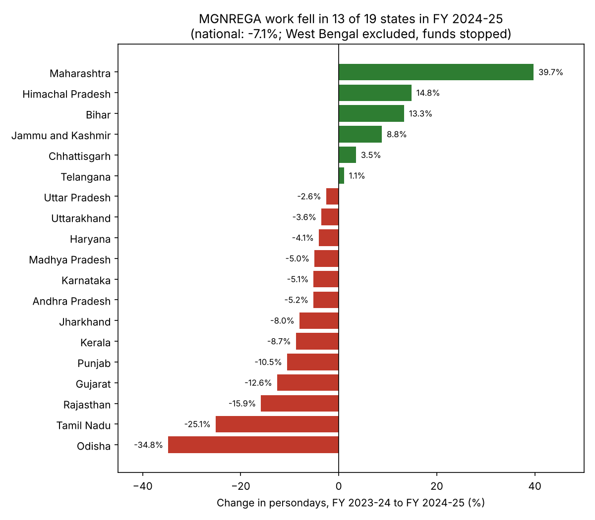

## The briefs

**[From MGNREGA to VB-G RAM G: Implementation Gaps](briefs/vb-g-ram-g-implementation-brief.md)** ([PDF](briefs/vb-g-ram-g-implementation-brief.pdf))

MGNREGA was replaced in July 2026 by a new law that promises 125 days of work instead of 100. But households were getting about 48 days on average under the old law. So I looked at why the old guarantee wasn't met, and what the new cost-sharing model means for states that were already struggling. It includes a small state-level data analysis, six recommendations, and draft Parliamentary Questions.

**[Digital Personal Data Protection Act, 2023](briefs/dpdp-act-legislative-brief.md)** ([PDF](briefs/dpdp-act-legislative-brief.pdf))

India's data protection law comes fully into force in May 2027. The brief covers what it requires and how it compares with Europe's GDPR. It focuses on three things I think deserve more attention: the change to the RTI Act, how independent the Data Protection Board really is, and how easily the government can exempt itself.

## The data analysis

The [`mgnrega-analysis`](mgnrega-analysis) folder has the Python script behind the MGNREGA findings. It compares how much work each state generated in FY 2023-24 and FY 2024-25, and checks how many workers can't receive Aadhaar-based payments.



A few things that stood out:

- Work fell in 13 of 19 major states, with Odisha down almost 35%.
- Maharashtra's work went up by 40%, yet 63% of its registered workers can't currently be paid through the Aadhaar-based system.
- West Bengal had no MGNREGA work at all, because central funds have been stopped since 2022.

To run it:

```bash
cd mgnrega-analysis
pip install pandas matplotlib
python analysis.py
```

The state-level numbers come from LibTech India's national tracker, which is compiled from the official NREGA dashboard. Wage figures come from PRS Legislative Research. Full sources are listed at the end of each brief.

## Contact

Prashant Yadav · [LinkedIn](https://linkedin.com/in/prashant-yadav-0a8090334) · yprashantrao12345@gmail.com
